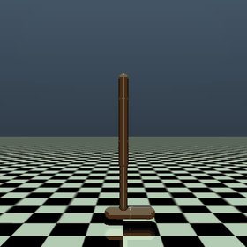
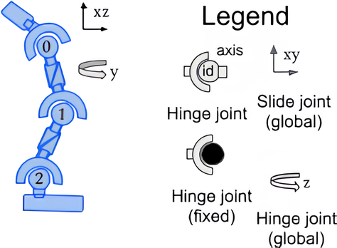
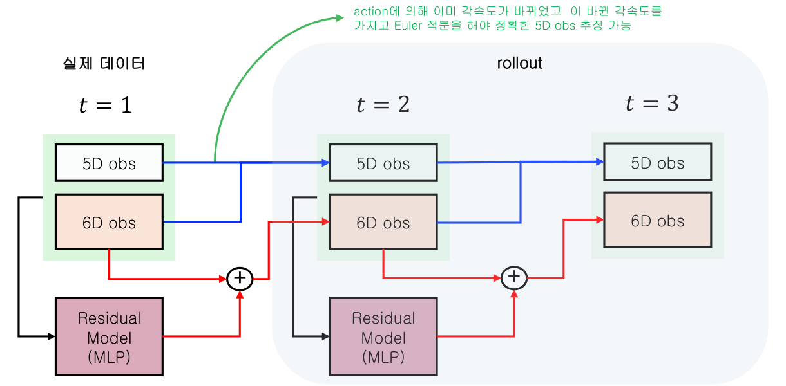
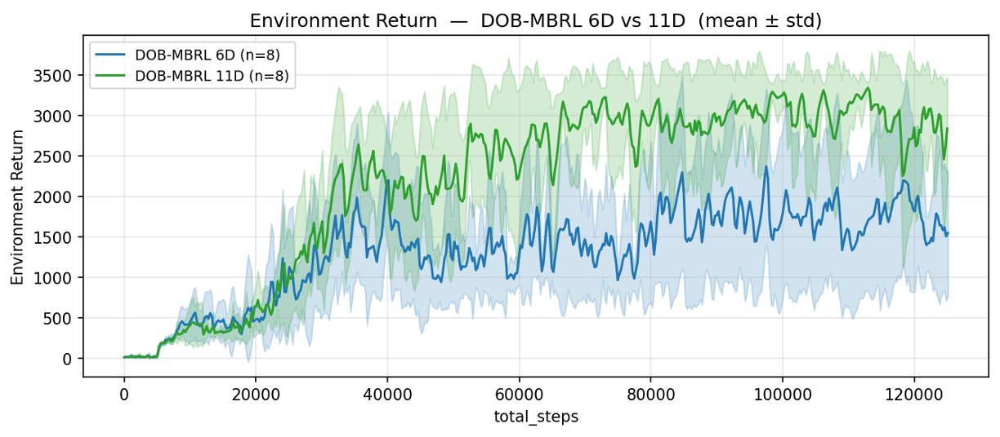
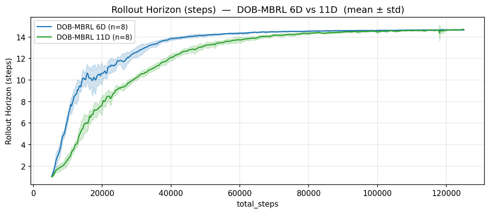
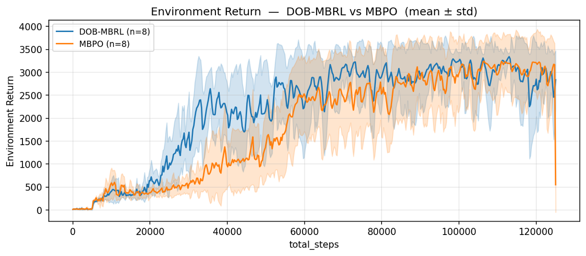

# DOB-MBRL

**Disturbance Observer 기반 Model-Based Reinforcement Learning**

단순한 물리 기반 명목(nominal) 모델에 **Disturbance Observer(DOB)** 와 **학습된 residual 모델**을 더해 환경 동역학을 근사하고, 이 모델로 생성한 가상 경험으로 정책을 학습하는 연구 프로젝트.

- 실험 환경: **Gymnasium MuJoCo `Hopper-v5`**
- 정책 학습: **Soft Actor-Critic(SAC)**
- 비교 대상: **MBPO**

<p align="center">
  
  &nbsp;&nbsp;
  
</p>
<p align="center"><sub>왼쪽: Hopper-v5 환경 &nbsp;|&nbsp; 오른쪽: torso–thigh–leg–foot와 세 개의 hinge joint</sub></p>

---

## 이 프로젝트가 풀려는 문제

- Model-based RL은 환경 모델로 가상 경험을 생성해 샘플 효율을 높이는 방법
- 하지만 동역학 전체를 신경망 하나로 학습하면 rollout 중 모델 오차가 누적되고, 모델을 어디까지 믿어도 되는지 판단하기 어려움
- DOB-MBRL은 동역학을 세 부분으로 나눠 이 문제에 접근

| 구성 요소 | 역할 |
|---|---|
| **Nominal model** | 위치를 현재 속도로 적분하는 단순 운동학 모델. 빠르고 구조가 명확하지만 중력·접촉·토크는 고려하지 않음 |
| **DOB + Residual model** | 실제 전이와 nominal 예측의 차이(외란)를 DOB로 추정하고, residual MLP가 이를 `(상태, 행동)`의 함수로 학습 |
| **RBF uncertainty model** | residual 모델이 아직 설명하지 못한 오차를 추정해, 신뢰할 수 없는 rollout을 조기에 중단 |

핵심 아이디어: **물리적으로 알고 있는 부분은 nominal 모델이, 모르는 부분은 DOB와 residual 모델이 담당**하도록 역할을 분리

## 동역학 모델 상세

### Hopper 관측과 행동

- 관측: 11차원
- 행동: 세 관절(thigh, leg, foot)의 토크 입력 3차원, 범위 `[-1, 1]`

| 인덱스 | 의미 | 구분 |
|---:|---|---|
| 0 | torso 높이 `z` | 위치 |
| 1 | torso 각도 | 위치 |
| 2–4 | thigh, leg, foot 관절 각도 | 위치 |
| 5 | torso 전진 속도 `vx` | 속도 |
| 6 | torso 수직 속도 `vz` | 속도 |
| 7–10 | torso 및 세 관절의 각속도 | 속도 |

### 1. Nominal model

```text
q(t+1) = q(t) + q̇(t) · dt        # 위치 5개 (obs[0:5] += obs[6:11] · dt)
v(t+1) = v(t)                     # 속도 6개는 그대로
dt = 0.008 s                      # frame_skip 4 × timestep 0.002
```

- 행동, 중력, 접촉력을 전혀 고려하지 않음
- 실제 전이와의 차이는 모두 DOB와 residual 모델의 학습 대상

### 2. DOB와 residual model

```text
e     = (s' - s) - Δs_nom                          # nominal이 설명하지 못한 변화
d̂     = dob_w · Δs_res + (1 - dob_w) · (FPINV @ e)  # DOB 외란 추정 (dob_w = 0.1)
loss  = MSE(ResidualMLP(s, a), d̂)
```

- 입력: `[obs(11), action(3)]`
- 구조: 256-unit hidden layer 4개
- Rollout의 다음 상태 계산

```text
s' = s + Δs_nom + F_MAT @ ResidualMLP(s, a)
```

### 3. RBF uncertainty model

- Normalized RBF 모델(center 3,000개)로 `|FPINV @ e - Δs_res|`, 즉 residual 모델의 남은 오차를 학습
- Rollout 중 예측 uncertainty의 L2 norm이 임계값(기본 `1.5`)을 넘으면 해당 trajectory를 중단하고, 그 step은 model buffer에 저장하지 않음

### 4. 모델 rollout의 보상과 종료

- Rollout에서는 보상과 종료를 관측만으로 계산 ([`hopper_utils.py`](cycles/Cycle_1-dob-mbrl/dob_mbrl/envs/hopper_utils.py))

```text
reward = forward_reward + healthy_reward - 0.001 · Σ action²
done   = z < 0.7  or  |torso angle| > 0.2  or  상태 범위 이탈
```

## 실험 내용

### 6D 보정에서 11D 보정으로

- 초기 설계(6D): 위치 5개는 nominal 모델의 Euler 적분에 맡기고, residual 모델은 속도 6개만 보정
- 문제: rollout이 길어질수록 아래와 같은 오차 누적 발생

<p align="center">
  
</p>
<p align="center"><sub>파란 선: nominal 적분 경로, 빨간 선: residual 보정 경로</sub></p>

- 위치(5D)가 **이전 step의 속도**로 적분되므로, action으로 이미 바뀐 속도가 한 step 늦게 반영됨
- 이 위치 오차가 rollout 동안 누적되고, 누적된 상태가 다시 residual 모델의 입력으로 들어감
- 입력 분포가 실제 trajectory에서 벗어나면서 속도(6D) 예측까지 함께 악화

**조치**: residual 모델이 **11차원 전체 상태를 보정**하는 방식(`correct_position=True`)을 기본값으로 변경. 6D 방식은 `--no-position-correction` 옵션으로 비교 실험 가능

<p align="center">
  
</p>
<p align="center">
  
</p>
<p align="center"><sub>6D vs 11D 보정, 각 8 seeds의 평균 ± 표준편차 (위: environment return, 아래: uncertainty 검사를 통과한 평균 rollout 길이)</sub></p>

- Rollout horizon: 학습 초반에는 11D가 6D보다 짧았으나 약 80k step 이후 비슷한 수준
- Environment return: 약 40k step 이후 11D가 6D보다 뚜렷하게 높게 유지

### MBPO와 비교

<p align="center">
  
</p>
<p align="center"><sub>DOB-MBRL(11D 보정) vs MBPO, 각 8 seeds, 125k environment steps</sub></p>

- MBPO는 [`cycles/Cycle_1-mbpo/`](cycles/Cycle_1-mbpo/)에 PyTorch로 재구현 (probabilistic ensemble 7개, elite 5개)
- 같은 step 예산에서 DOB-MBRL이 학습 초중반(약 25k–60k step)에 더 빠르게 return 상승
- 후반에는 두 방법이 비슷한 수준에 도달

> **참고**: 위 그래프들은 이전 실험 기록. 해당 실행의 원본 결과 파일(`results/`, `checkpoints/`)은 저장소에 포함되어 있지 않으므로, 재현된 최종 성능이 아닌 연구 경과로 해석 필요

## 저장소 구조

```text
DOB-RL/
├── cycles/                         # 실험 단위(Cycle)별 구현 — 모든 개발은 여기서
│   ├── Cycle_1-dob-mbrl/           # ★ 현재 DOB-MBRL 구현 (Hopper-v5, SAC)
│   │   ├── dob_mbrl/
│   │   │   ├── dynamics/           # nominal 모델, DOB, 상태/행동 상수
│   │   │   ├── envs/               # Hopper 보상·종료 함수
│   │   │   ├── models/             # SAC actor/critic, residual MLP, RBF
│   │   │   ├── training/           # config, 학습 루프, 모델 학습, rollout
│   │   │   └── utils/              # real/model replay buffer
│   │   ├── main.py                 # 단일 seed 실행 진입점
│   │   ├── CYCLE_REPORT.md         # Cycle 실험 보고서
│   │   └── RBF_*.md                # RBF uncertainty 설계 메모
│   └── Cycle_1-mbpo/               # 비교용 MBPO 구현
├── base/                           # CartPole + DQN 초기 이식본과 원본 코드 (수정 금지 아카이브)
├── docs/
│   ├── images/                     # README 이미지
│   └── slides/                     # 랩미팅 발표 자료 (.pptx)
├── experiments_log.md              # 실험 기록
└── requirements.txt
```

- 출발점은 **CartPole + DQN**(`base/`), 이후 Hopper + SAC로 확장
- 새 실험은 `cycles/Cycle_N-*/` 폴더를 새로 만들어 진행하며, `base/`는 수정하지 않음

## 시작하기

### 설치

- Python 3.10 이상 권장

```bash
python -m venv .venv
source .venv/bin/activate
pip install -r requirements.txt
pip install "gymnasium[mujoco]"
```

- CUDA 사용 시 시스템 CUDA 버전에 맞는 PyTorch 빌드를 별도로 설치

### 실행

```bash
cd cycles/Cycle_1-dob-mbrl
python main.py --seed 1 --gpu 0 --checkpoint-dir ./checkpoints
```

- CPU 실행 시 `--gpu -1` 사용

| 옵션 | 설명 |
|---|---|
| `--seed N` | 랜덤 seed (기본값 1) |
| `--gpu N` | GPU 인덱스, `-1`이면 CPU |
| `--checkpoint-dir PATH` | checkpoint 저장 위치 |
| `--resume` | 가장 최근 checkpoint에서 이어서 학습 |
| `--real-ratio R` | 혼합 배치의 실제 데이터 비율 |
| `--uncertainty-threshold T` | rollout uncertainty 임계값 |
| `--rollout-batch-size N` | rollout 시작 상태 수 |
| `--no-position-correction` | 11D 대신 6D(속도만) residual 보정 사용 |
| `--num-threads N` | PyTorch CPU thread 수 |

> 기본 `rollout_batch_size=100000`은 원본 MBPO 설정을 따른 값으로 메모리와 계산량이 큼. 로컬에서 처음 실행할 때는 `--rollout-batch-size 10000`처럼 낮춰서 확인 권장

### 출력

```text
results/real_ratio=..._num_gstep=.../
├── config.json              # 실행 설정
├── seed_N_progress.csv      # reward, eval reward, model error, uncertainty, rollout 통과율·horizon
└── seed_N_result.pkl        # episode별 reward와 metric

checkpoints/real_ratio=..._num_gstep=.../
├── Resume_SeedN_Latest.pt   # 매 episode 저장, --resume에 사용
└── Champion_SeedN_BestModel.pt  # 최근 10 episode 평균 reward ≥ 2,000에서 최고 기록 갱신 시 저장
```

## 기본 하이퍼파라미터

- 전체 설정은 [`config.py`](cycles/Cycle_1-dob-mbrl/dob_mbrl/training/config.py)에 있으며, 파일을 직접 수정해 변경

| 항목 | 값 | 항목 | 값 |
|---|---:|---|---:|
| 전체 환경 step | 125,000 | Real data ratio | 0.05 |
| Warm start | 5,000 | DOB weight `dob_w` | 0.1 |
| Batch size | 256 | RBF centers / width | 3,000 / 0.5 |
| SAC gradient steps / env step | 5 | Uncertainty threshold | 1.5 |
| Actor·Critic lr | 3e-4 | Rollout batch size | 100,000 |
| Residual lr | 1e-3 | Rollout horizon | 15 |
| Discount `γ` / `τ` | 0.99 / 0.005 | Model 학습·rollout 주기 | 250 step |